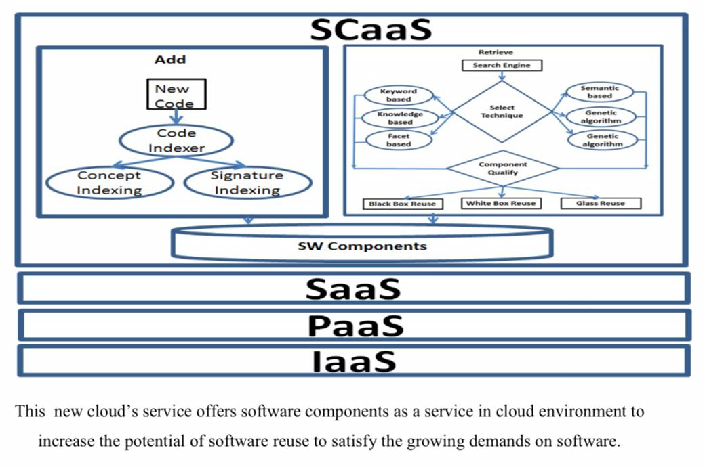

# SCaaS: Software Components as a Service
# خدمة المكوّنات البرمجية كخدمة سحابية

> **Status / الحالة:** research idea and starting point. No working cloud service or code yet. Not an official government project.
> فكرة بحثية ونقطة بداية. لا توجد خدمة سحابية عاملة ولا كود تشغيلي حتى الآن. وليس مشروعًا حكوميًا رسميًا.

## الفكرة (عربي)

SCaaS طبقة خدمة سحابية جديدة تعرض **المكوّنات البرمجية كخدمة** فوق طبقات IaaS و PaaS و SaaS، لزيادة إعادة استخدام البرمجيات وتلبية الطلب المتزايد على البرمجيات.

من الرسم:

- **الإضافة (Add):** كود جديد يمر على *Code Indexer* الذي يفهرسه بطريقتين: فهرسة بالمفهوم (Concept Indexing) وفهرسة بالتوقيع (Signature Indexing)، ثم يُخزَّن في مخزن المكوّنات (SW Components).
- **الاسترجاع (Retrieve):** محرك بحث يختار تقنية البحث (كلمات مفتاحية، قائمة على المعرفة، بالأوجه Facet، دلالي Semantic، خوارزميات جينية)، ثم يتحقق من صلاحية المكوّن (Component Qualify)، ثم إعادة الاستخدام: Black Box أو White Box أو Glass Box.

## الربط بفكرة الحوسبة السحابية الوطنية

الفكرة المقترحة أن تكون SCaaS قلب منصة بحثية وتطويرية على حوسبة سحابية وطنية، تمهيدًا لتوطين تطبيقات الذكاء الاصطناعي وتصديرها. الخدمات المقترحة (أفكار للنقاش، وليست قائمة بما هو موجود):

1. بريد إلكتروني وطني.
2. تطبيقات ذكاء اصطناعي تعمل على السحابة الوطنية.
3. ألعاب إلكترونية بحساب موحد وخدمة السحابة.
4. بوابة إعلام وصحافة إلكترونية على السحابة الوطنية.
5. استكمال ربط أجهزة الدولة بخدمات الحوسبة السحابية.
6. منصة بحثية توليدية على غرار GitHub، لكن على السحابة الوطنية، مبنية على SCaaS.

التطبيق المرجعي الأول: [منصة السلامة على الطرق ونقل المواد الخطرة](https://github.com/ebtessm/egypt-road-safety-platform) ([عرض تجريبي](https://ebtessm.github.io/egypt-road-safety-platform/)). كل مكوّن فيها (تقييم المخاطر، التنبيهات) يمكن أن يُنشر كمكوّن قابل لإعادة الاستخدام عبر SCaaS.

## English summary

SCaaS adds a "software components" service layer on top of IaaS, PaaS and SaaS to raise software reuse. New code goes through a code indexer (concept and signature indexing) into a component store. Retrieval uses a search engine that picks a technique (keyword, knowledge, facet, semantic, genetic algorithm), qualifies the component, then supports black-box, white-box or glass-box reuse.

The proposal here is to build a national-cloud research and development platform around SCaaS, to localize and export AI applications. First reference application: the [road safety platform](https://github.com/ebtessm/egypt-road-safety-platform).

## What exists now / ما الموجود فعلًا

- The diagram and this description only. / الرسم والوصف فقط.
- See [ROADMAP.md](ROADMAP.md) for proposed next steps. / خطوات مقترحة في ملف الخطة.

## Contributing

Open an issue to discuss ideas, or send a pull request. Experts in cloud computing, software reuse and public-sector IT are especially welcome.

## License

MIT, see [LICENSE](LICENSE). Copyright (c) 2026 Ebtessam Desouky and contributors.
